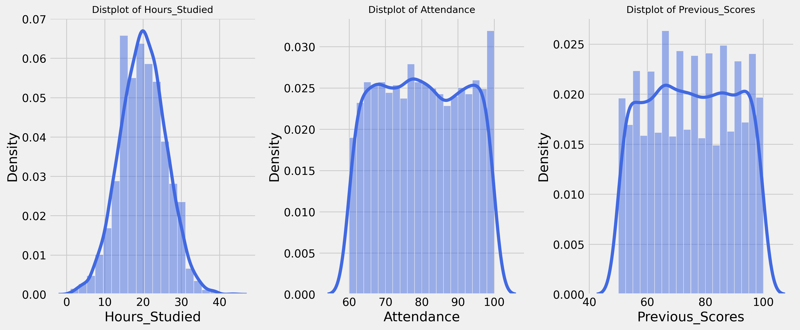
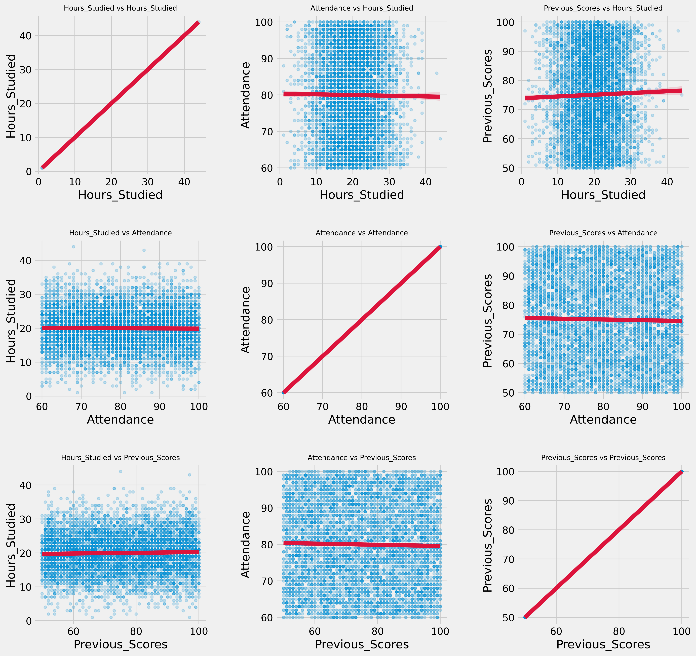
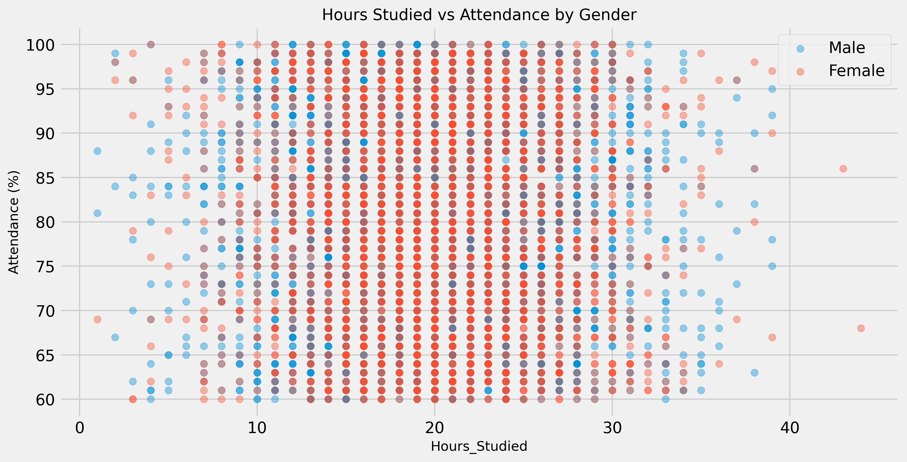
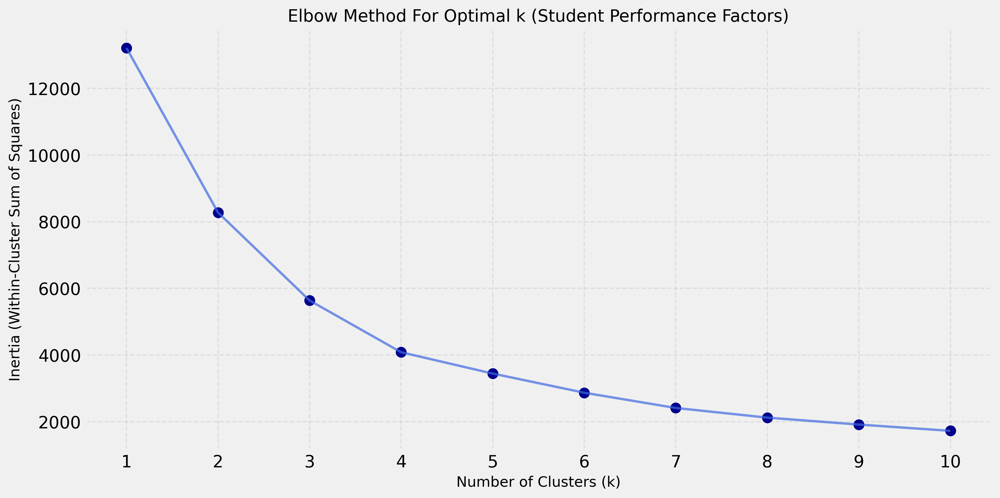
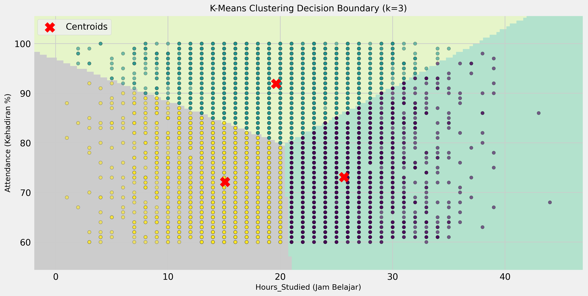
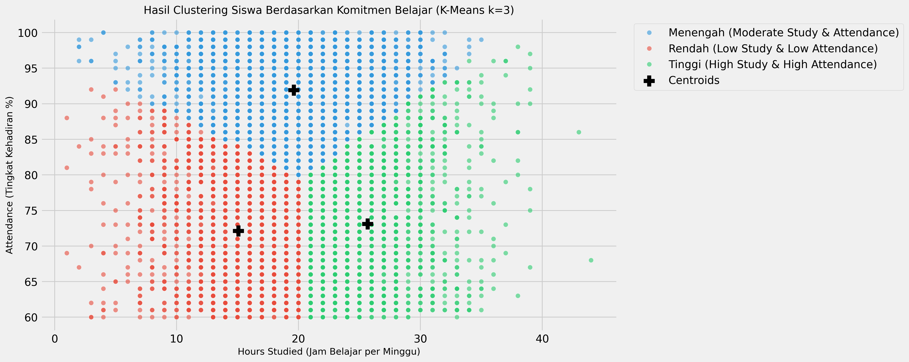
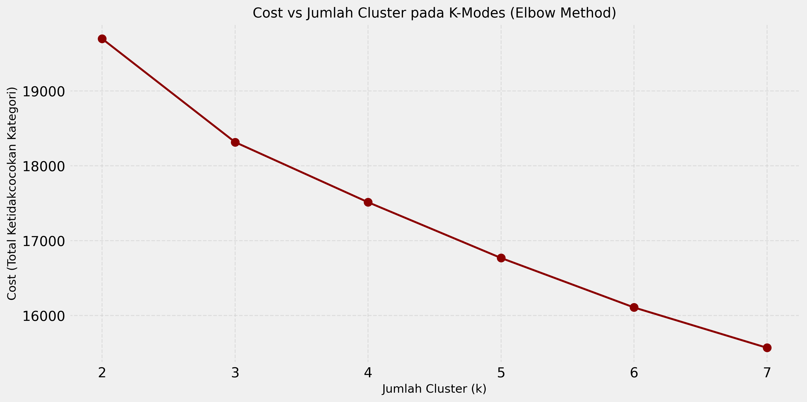
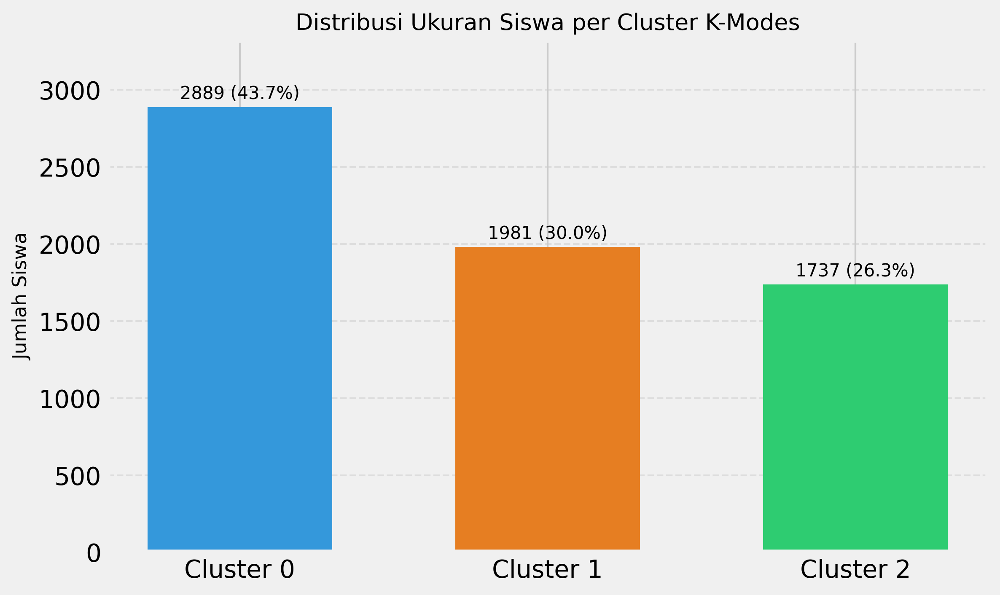
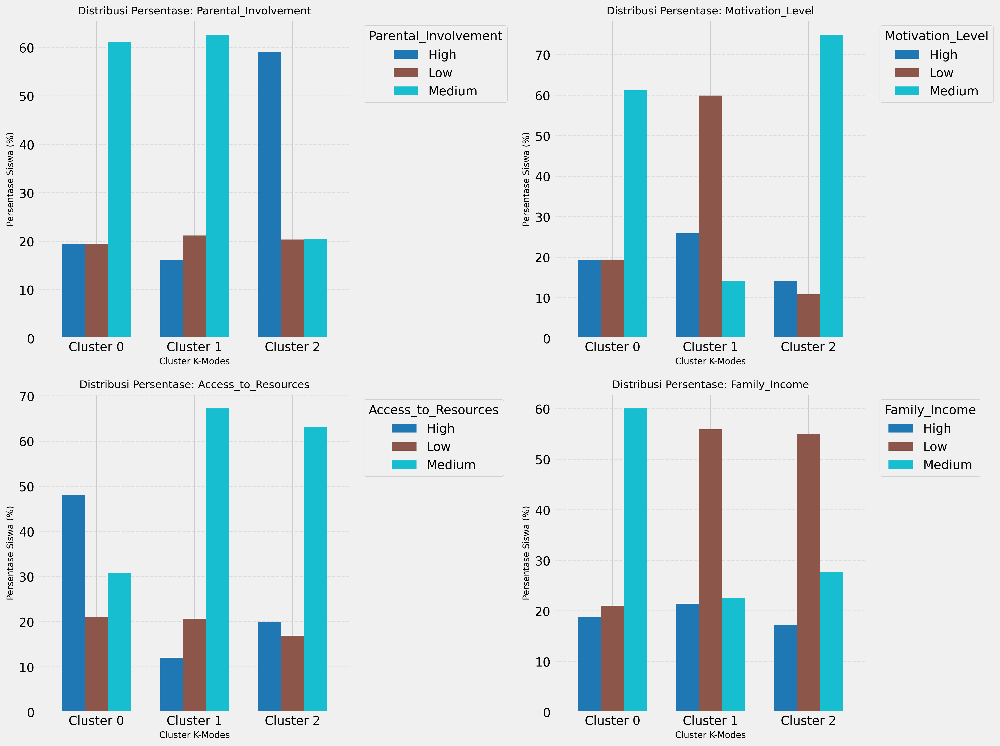
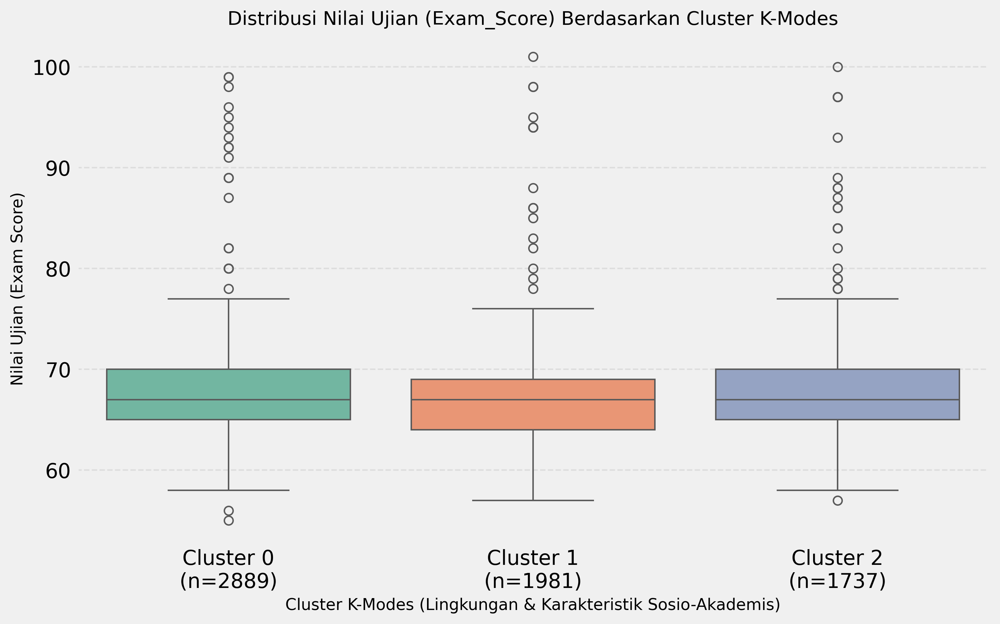

# LAPORAN PRAKTIKUM MACHINE LEARNING — MODUL 13: CLUSTERING
## TUGAS CLUSTERING DATASET MAHASISWA / SISWA (KELOMPOK GANJIL)

---

### Identitas Praktikum & Kelompok
- **Mata Kuliah**: Praktikum Machine Learning
- **Modul**: Modul 13 — Clustering (K-Means & K-Modes)
- **Kelompok**: Kelompok Ganjil
- **Dataset Utama**: *Student Performance Factors* (Kaggle)
- **Tahun Akademik**: 2026/2027

---

## 1. Judul Praktikum dan Identitas Kelompok

**Judul Praktikum**: Segmentasi Profil Siswa Berdasarkan Pola Kebiasaan Belajar dan Karakteristik Sosio-Akademis Menggunakan Algoritma K-Means dan K-Modes.

**Kelompok**: Kelompok Ganjil (Mandat Khusus: Wajib mengimplementasikan algoritma **K-Modes** sebagai metode perbandingan untuk data kategorikal).

---

## 2. Tujuan Praktikum

Praktikum ini bertujuan untuk:
1. Menerapkan tahapan analisis clustering secara komprehensif merujuk pada pedoman Modul 13 Praktikum Machine Learning, mulai dari eksplorasi data, pra-pemrosesan, deteksi outlier, penentuan jumlah cluster optimal, hingga pemodelan dan evaluasi.
2. Mengelompokkan data siswa berdasarkan variabel numerik komitmen belajar (*Hours Studied* dan *Attendance*) menggunakan algoritma **K-Means**.
3. Mengelompokkan data siswa berdasarkan variabel pendukung lingkungan dan sosio-akademis kategorikal (*Parental Involvement*, *Access to Resources*, *Motivation Level*, dll.) menggunakan algoritma **K-Modes**.
4. Menganalisis perbedaan performa evaluasi cluster (Elbow Method / Inertia, Cost, dan Silhouette Score) tanpa mencampuradukkan metrik jarak kontinu dan kategorikal.
5. Menghubungkan hasil segmentasi kedua algoritma dengan skor ujian akhir (*Exam Score*) secara post-hoc tanpa menyebabkan kebocoran target (*target leakage*).

---

## 3. Deskripsi Dataset dan Sumber Kaggle

Dataset yang digunakan secara eksklusif dalam praktikum ini diunduh langsung dari platform Kaggle:
- **Nama Dataset**: *Student Performance Factors*
- **Penulis / Publisher**: Lai Nguyen (`lainguyn123`)
- **Tautan Resmi**: [Kaggle: Student Performance Factors](https://www.kaggle.com/datasets/lainguyn123/student-performance-factors)
- **Format File**: CSV (`data/StudentPerformanceFactors.csv`)
- **Dimensi Aktual**: 6.607 baris observasi dan 20 kolom atribut.

### Rincian Atribut Dataset
Dataset ini memuat kombinasi atribut numerik dan kategorikal:

| No | Nama Kolom | Tipe Data | Skala / Kategori | Keterangan |
|---|---|---|---|---|
| 1 | `Hours_Studied` | Numerik (`int64`) | 1 – 44 jam/minggu | Jam belajar mandiri per minggu |
| 2 | `Attendance` | Numerik (`int64`) | 60 – 100 % | Persentase kehadiran kelas |
| 3 | `Parental_Involvement` | Kategorikal (`object`) | Low, Medium, High | Keterlibatan orang tua |
| 4 | `Access_to_Resources` | Kategorikal (`object`) | Low, Medium, High | Akses ke fasilitas/materi |
| 5 | `Extracurricular_Activities` | Kategorikal (`object`) | No, Yes | Partisipasi ekstrakurikuler |
| 6 | `Sleep_Hours` | Numerik (`int64`) | 4 – 10 jam | Rata-rata jam tidur per hari |
| 7 | `Previous_Scores` | Numerik (`int64`) | 50 – 100 | Nilai ujian periode sebelumnya |
| 8 | `Motivation_Level` | Kategorikal (`object`) | Low, Medium, High | Tingkat motivasi belajar |
| 9 | `Internet_Access` | Kategorikal (`object`) | No, Yes | Akses internet di rumah |
| 10 | `Tutoring_Sessions` | Numerik (`int64`) | 0 – 8 sesi/bulan | Jumlah sesi les tambahan |
| 11 | `Family_Income` | Kategorikal (`object`) | Low, Medium, High | Tingkat pendapatan keluarga |
| 12 | `Teacher_Quality` | Kategorikal (`object`) | Low, Medium, High | Penilaian kualitas pengajar |
| 13 | `School_Type` | Kategorikal (`object`) | Public, Private | Jenis sekolah |
| 14 | `Peer_Influence` | Kategorikal (`object`) | Negative, Neutral, Positive | Pengaruh teman sebaya |
| 15 | `Physical_Activity` | Numerik (`int64`) | 0 – 6 jam/minggu | Waktu aktivitas fisik |
| 16 | `Learning_Disabilities` | Kategorikal (`object`) | No, Yes | Hambatan belajar khusus |
| 17 | `Parental_Education_Level` | Kategorikal (`object`) | High School, College, Postgraduate | Tingkat pendidikan orang tua |
| 18 | `Distance_from_Home` | Kategorikal (`object`) | Near, Moderate, Far | Jarak tempat tinggal ke sekolah |
| 19 | `Gender` | Kategorikal (`object`) | Male, Female | Jenis kelamin siswa |
| 20 | `Exam_Score` | Numerik (`int64`) | 55 – 101 | Skor ujian akhir siswa |

---

## 4. Landasan Teori Singkat

### 4.1. Konsep Dasar Clustering
Clustering adalah metode pembelajaran tanpa pengawasan (*unsupervised learning*) yang bertujuan membagi sekumpulan objek data ke dalam beberapa kelompok (*cluster*) sedemikian rupa sehingga objek-objek di dalam satu cluster memiliki kemiripan (*similarity*) yang tinggi, sedangkan objek-objek antar-cluster memiliki ketidaksamaan (*dissimilarity*) yang sebesar mungkin.

### 4.2. Algoritma K-Means
K-Means merupakan algoritma partisi berbasis jarak Euclidean yang bekerja meminimalkan variansi dalam cluster (*Within-Cluster Sum of Squares* / WCSS / Inertia):

$$\text{Inertia} = \sum_{k=1}^K \sum_{x \in C_k} ||x - \mu_k||^2$$

di mana $\mu_k$ adalah titik pusat rata-rata (*centroid*) dari cluster $C_k$.
Kelemahan utama K-Means adalah sensitivitasnya terhadap skala fitur (sehingga membutuhkan standardisasi) dan ketidakmampuannya menangani variabel non-metrik/kategorikal.

### 4.3. Algoritma K-Modes
Algoritma K-Modes (dikembangkan oleh Zhexue Huang, 1998) dirancang khusus untuk data kategorikal. Perbedaan mendasarnya dari K-Means adalah:
1. **Pusat Cluster**: Menggunakan nilai modus (*modes*) dari masing-masing kategori, bukan nilai rata-rata aritmetika (*means*).
2. **Fungsi Jarak/Disimilaritas**: Menggunakan *Simple Matching Dissimilarity* (Hamming distance):

$$d(X, Y) = \sum_{j=1}^m \delta(x_j, y_j) \quad \text{di mana} \quad \delta(x_j, y_j) = \begin{cases} 0, & \text{jika } x_j = y_j \\ 1, & \text{jika } x_j \neq y_j \end{cases}$$

3. **Fungsi Objektif (Cost)**: Meminimalkan total ketidakcocokan kategori antara objek dengan modus clusternya:

$$\text{Cost} = \sum_{k=1}^K \sum_{i \in C_k} d(X_i, Q_k)$$

di mana $Q_k$ adalah vektor modus cluster ke-$k$.

---

## 5. Persiapan Data dan Preprocessing

Sesuai urutan langkah pada Modul 13:
1. **Pemeriksaan Dimensi & Struktur**: Dataset memiliki 6.607 baris dan 20 kolom tanpa duplikasi baris (`duplicated().sum() == 0`).
2. **Pemeriksaan Missing Values**:
   - Kolom numerik tidak memiliki missing values.
   - Kolom kategorikal yang memiliki missing values:
     - `Parental_Education_Level`: 90 nilai kosong (1.36%)
     - `Teacher_Quality`: 78 nilai kosong (1.18%)
     - `Distance_from_Home`: 67 nilai kosong (1.01%)
   - **Strategi Imputasi**: Untuk variabel kategorikal yang digunakan pada K-Modes (`Teacher_Quality`), dilakukan imputasi dengan nilai modus ('Medium') agar tidak mendistorsi distribusi kategori aktual.
3. **Pemeriksaan Outlier**:
   - Metode Interquartile Range (IQR = $Q_3 - Q_1$) mendeteksi 43 observasi outlier pada `Hours_Studied` (0.65%) dan 430 observasi pada `Tutoring_Sessions` (6.51%). Fitur `Attendance` tidak memiliki outlier (rentang 60 - 100%). Outlier pada `Hours_Studied` (nilai hingga 44 jam) tetap dipertahankan karena secara pedagogis merepresentasikan siswa dengan dedikasi belajar ekstrem, bukan kesalahan input (*data entry error*).
4. **Pencegahan Target Leakage**:
   - Kolom `Exam_Score` **tidak dilibatkan** dalam proses clustering K-Means maupun K-Modes. Tujuannya adalah mengelompokkan siswa murni dari kebiasaan dan lingkungan belajar mereka, kemudian mengevaluasi secara post-hoc apakah cluster tersebut secara alamiah berkorelasi dengan hasil ujian.

---

## 6. Implementasi K-Means

Sesuai modul praktikum:
- **Fitur Terpilih**: `Hours_Studied` dan `Attendance`. Kedua variabel ini merepresentasikan komitmen belajar langsung dari siswa (waktu mandiri dan kehadiran formal).
- **Standardisasi**: Dilakukan dengan `StandardScaler` dari scikit-learn karena `Hours_Studied` berpusat di rata-rata 19.98 jam (std 5.99) sedangkan `Attendance` berpusat di rata-rata 79.98% (std 11.55). Tanpa standardisasi, fitur kehadiran akan mendominasi perhitungan jarak Euclidean.
- **Visualisasi Awal**:
  1. *Distribusi Fitur*: Histogram dengan kurva KDE.
  2. *Relasi Antar Fitur*: Matrix scatter regresi linear.
  3. *Sebaran Gender*: Plot sebaran berdasarkan jenis kelamin.

*Gambar 1: Distribusi frekuensi variabel numerik utama dengan kurva estimasi densitas (KDE).*

*Gambar 2: Matriks hubungan antar-fitur komitmen belajar siswa.*

*Gambar 3: Sebaran Hours Studied vs Attendance dipisahkan berdasarkan Gender.*

---

## 7. Hasil Elbow Method dan Alasan Pemilihan Nilai k (K-Means)

Pengujian dilakukan untuk nilai $k \in [1, 10]$ menggunakan `n_init=10` dan `random_state=111`.

### Tabel Hasil Evaluasi Inertia & Silhouette Score:
| Jumlah Cluster ($k$) | Inertia (WCSS) | Silhouette Score | Keterangan |
|---|---|---|---|
| $k=1$ | 13.214,00 | — | Titik awal (1 cluster) |
| $k=2$ | 8.274,38 | 0,3619 | Penurunan tajam |
| **$k=3$** | **5.636,71** | **0,3584** | **Siku optimal (*Elbow Point*)** |
| $k=4$ | 4.083,72 | 0,3495 | Penurunan mulai melandai |
| $k=5$ | 3.444,51 | 0,3353 | Penurunan marjinal |
| $k=6$ | 2.869,65 | 0,3466 | Peningkatan kompleksitas |
| $k=7$ | 2.412,13 | — | Penurunan linier |
| $k=8$ | 2.122,00 | — | Over-segmentasi |
| $k=9$ | 1.914,20 | — | Over-segmentasi |
| $k=10$ | 1.725,86 | — | Over-segmentasi |

*Gambar 4: Kurva Elbow Method menunjukkan patahan sudut paling signifikan pada $k=3$.*

**Alasan Pemilihan $k = 3$**:
1. **Analisis Kurva Elbow**: Titik infleksi tertajam terjadi pada perpindahan dari $k=2$ ke $k=3$ (penurunan inertia sebesar 2.637,67 poin). Setelah $k=3$, penurunan inertia melandai secara konsisten.
2. **Kestabilan Silhouette Score**: Nilai Silhouette Score pada $k=3$ mencapai **0,3584**, sangat kompetitif terhadap $k=2$ (0,3619) dan lebih tinggi dibandingkan $k=4$ (0,3495) dan $k=5$ (0,3353).
3. **Interpretasi Bisnis / Pendidikan**: $k=3$ membagi spektrum perilaku belajar secara alami menjadi tiga tingkatan siswa yang sangat jelas dan actionable:
   - Siswa Disiplin Kehadiran Tinggi (*High Attendance, Consistent Effort*)
   - Siswa Belajar Mandiri Tinggi (*High Self-Study, Moderate Attendance*)
   - Siswa Kurang Terlibat / Berisiko (*Low Study, Low Attendance / At-Risk*)

---

## 8. Visualisasi dan Interpretasi Cluster K-Means

Model final dibangun menggunakan `KMeans(n_clusters=3, init='k-means++', n_init=10, max_iter=300, random_state=111)`.

### Koordinat Centroid pada Skala Asli:
- **Cluster 0**: Jam Belajar = **25,67 jam**, Kehadiran = **73,10 %**
- **Cluster 1**: Jam Belajar = **19,61 jam**, Kehadiran = **91,91 %**
- **Cluster 2**: Jam Belajar = **15,09 jam**, Kehadiran = **72,10 %**

*Gambar 5: Visualisasi Decision Boundary K-Means dengan meshgrid sesuai Modul 13 Bagian 12–13.*

*Gambar 6: Scatter plot hasil segmentasi siswa berdasarkan jam belajar dan persentase kehadiran.*

### Tabel Karakteristik dan Profil Cluster K-Means:
| ID Cluster | Label Profil | Jumlah Siswa | Proporsi | Rata-rata Jam Belajar | Rata-rata Kehadiran | Rata-rata Nilai Ujian (`Exam_Score`) |
|---|---|---|---|---|---|---|
| **Cluster 1** | Siswa Berdisiplin Tinggi (*High Attendance & Steady Study*) | 2.528 | 38,26% | 19,61 jam | **91,91 %** | **69,45** |
| **Cluster 0** | Siswa Mandiri Aktif (*High Self-Study & Moderate Attendance*) | 1.971 | 29,83% | **25,67 jam** | 73,10 % | **67,53** |
| **Cluster 2** | Siswa Rentan / Kurang Terlibat (*Low Study & Low Attendance*) | 2.108 | 31,91% | 15,09 jam | 72,10 % | **64,31** |

### Interpretasi Hasil:
1. **Cluster 1 (Siswa Berdisiplin Tinggi)**: Memiliki tingkat kehadiran tertinggi (91,91%) dengan jam belajar mandiri teratur (19,61 jam). Menariknya, kelompok ini menghasilkan rata-rata nilai ujian tertinggi (**69,45**). Hal ini menunjukkan bahwa konsistensi kehadiran di kelas formal memiliki korelasi kuat terhadap pencapaian akademik.
2. **Cluster 0 (Siswa Mandiri Aktif)**: Memiliki jam belajar mandiri tertinggi (25,67 jam) namun kehadiran di kelas berada pada tingkat moderat (73,10%). Kelompok ini berhasil meraih nilai rata-rata ujian yang baik (**67,53**).
3. **Cluster 2 (Siswa Kurang Terlibat / At-Risk)**: Memiliki jam belajar terendah (15,09 jam) dan kehadiran terendah (72,10%). Dampaknya terlihat nyata pada nilai ujian akhir yang paling rendah (**64,31**). Kelompok ini memerlukan intervensi bimbingan akademik.

---

## 9. Implementasi K-Modes (Tugas Wajib Kelompok Ganjil)

Sesuai ketentuan kelompok ganjil, program `kmodes_clustering.py` diimplementasikan untuk data kategorikal tanpa melakukan konversi angka biasa (*label encoding*) yang keliru mengasumsikan jarak metrik.

### Fitur Kategorikal yang Dipilih (8 Fitur Dukungan & Motivasi):
1. `Parental_Involvement`
2. `Access_to_Resources`
3. `Motivation_Level`
4. `Internet_Access`
5. `Family_Income`
6. `Teacher_Quality` (diimputasi nilai modusnya yaitu 'Medium')
7. `Peer_Influence`
8. `Extracurricular_Activities`

Model dibangun menggunakan `kmodes.kmodes.KModes` dengan parameter `init='Huang'`, `n_init=10`, dan `random_state=42`.

---

## 10. Hasil Pemilihan Jumlah Cluster K-Modes

Pengujian dilakukan untuk nilai $k \in [2, 7]$. Evaluasi dicatat menggunakan nilai Cost (total ketidakcocokan kategori), rata-rata ketidakcocokan per siswa, serta *Hamming Silhouette Score*.

### Tabel Hasil Evaluasi K-Modes:
| Jumlah Cluster ($k$) | Total Cost | Rata-rata Ketidakcocokan per Siswa | Hamming Silhouette Score | Keterangan |
|---|---|---|---|---|
| $k=2$ | 19.699,0 | 2,982 | 0,1323 | Partisi terlalu umum |
| **$k=3$** | **18.317,0** | **2,772** | **0,1013** | **Optimal (Profil paling seimbang & representatif)** |
| $k=4$ | 17.514,0 | 2,651 | 0,1013 | Peningkatan marjinal |
| $k=5$ | 16.769,0 | 2,538 | 0,0744 | Silhouette menurun drastis |
| $k=6$ | 16.108,0 | 2,438 | 0,1006 | Redundansi cluster |
| $k=7$ | 15.569,0 | 2,356 | 0,1068 | Fragmentasi tinggi |

*Gambar 7: Kurva Cost (Hamming Dissimilarity) terhadap jumlah cluster pada K-Modes.*

**Alasan Pemilihan $k = 3$ pada K-Modes**:
- Pada clustering kategorikal, penambahan nilai $k$ secara alami akan selalu menurunkan nilai Cost karena data dipecah ke dalam lebih banyak subkelompok (*overfitting* partisi).
- Penurunan cost dari $k=2$ ke $k=3$ sangat substansial (penurunan 1.382 titik ketidakcocokan).
- Pada $k=3$, modus cluster membentuk representasi arketipe sosio-akademis yang logis, terpisah secara kualitatif, dan ukuran anggotanya seimbang (43,73%, 29,98%, dan 26,29%).

---

## 11. Visualisasi dan Interpretasi Cluster K-Modes

### Centroid Modus Kategori Masing-Masing Cluster:
| Atribut | Cluster 0 | Cluster 1 | Cluster 2 |
|---|---|---|---|
| `Parental_Involvement` | **Medium** | **Medium** | **High** |
| `Access_to_Resources` | **High** | **Medium** | **Medium** |
| `Motivation_Level` | **Medium** | **Low** | **Medium** |
| `Internet_Access` | **Yes** | **Yes** | **Yes** |
| `Family_Income` | **Medium** | **Low** | **Low** |
| `Teacher_Quality` | **Medium** | **Medium** | **Medium** |
| `Peer_Influence` | **Positive** | **Positive** | **Neutral** |
| `Extracurricular_Activities` | **No** | **Yes** | **Yes** |

*Gambar 8: Jumlah dan persentase siswa pada masing-masing cluster K-Modes.*

*Gambar 9: Distribusi persentase atribut kategorikal utama di dalam setiap cluster K-Modes.*

*Gambar 10: Boxplot perbandingan nilai ujian akhir (Exam Score) antar-cluster K-Modes.*

### Tabel Profil dan Ukuran Cluster K-Modes:
| ID Cluster | Jumlah Anggota | Proporsi | Karakteristik Utama Modus | Rata-rata Nilai Ujian |
|---|---|---|---|---|
| **Cluster 0** | 2.889 siswa | 43,73% | Fasilitas Lengkap (*Access High*), Pendapatan Menengah, Teman Positif, Fokus Akademik (*No Ekskul*) | **67,31** |
| **Cluster 1** | 1.981 siswa | 29,98% | Motivasi Rendah, Pendapatan Rendah, Fasilitas Menengah, Aktif Ekskul, Teman Positif | **66,90** |
| **Cluster 2** | 1.737 siswa | 26,29% | Keterlibatan Ortu Tinggi (*High*), Motivasi Menengah, Pendapatan Rendah, Pengaruh Teman Netral | **67,50** |

### Interpretasi Hasil:
1. **Cluster 0 (Siswa Berfasilitas Memadai)**: Memiliki akses sumber daya tinggi (*High Access*) dan status ekonomi menengah (*Medium Income*). Kelompok ini memilih tidak mengikuti ekstrakurikuler (*No*), menunjukkan fokus waktu utama pada studi.
2. **Cluster 1 (Siswa Ekonomi Rentan dengan Motivasi Rendah)**: Dicirikan oleh pendapatan keluarga rendah (*Low Income*), motivasi belajar rendah (*Low Motivation*), namun aktif berpartisipasi dalam ekstrakurikuler.
3. **Cluster 2 (Siswa dengan Dukungan Keluarga Kuat)**: Meskipun berasal dari keluarga berpendapatan rendah, kelompok ini memiliki keterlibatan orang tua yang paling tinggi (*High Parental Involvement*). Dukungan orang tua ini berhasil mengimbangi keterbatasan ekonomi, terbukti dari rata-rata nilai ujian yang tertinggi (**67,50**) di antara seluruh cluster kategorikal.

---

## 12. Perbandingan K-Means dan K-Modes

Berikut adalah perbandingan mendalam antara kedua algoritma yang diterapkan pada dataset *Student Performance Factors*:

| Aspek Perbandingan | K-Means Clustering | K-Modes Clustering (Kelompok Ganjil) |
|---|---|---|
| **Tipe Data Input** | Data Kontinu / Numerik (`Hours_Studied`, `Attendance`) | Data Diskrit / Kategorikal (8 fitur lingkungan & motivasi) |
| **Pusat Cluster (Centroid)** | Vektor Rata-rata (*Means*) kontinu dalam ruang vektor | Vektor Modus (*Modes*) dari nilai kategori paling sering |
| **Fungsi Jarak / Metrik** | Euclidean Distance ($L_2$ norm) | Simple Matching Dissimilarity (Hamming Distance) |
| **Metode Penentuan $k$** | Elbow Method berbasis Inertia (WCSS) & Silhouette Score | Elbow Method berbasis Cost (Total Mismatch) |
| **Nilai $k$ Terpilih** | $k = 3$ | $k = 3$ |
| **Skor Evaluasi $k=3$** | Inertia: 5.636,71 \| Silhouette Score: 0,3584 | Cost: 18.317,0 \| Hamming Silhouette: 0,1013 |
| **Ukuran Cluster** | C0: 1.971 (29,8%), C1: 2.528 (38,3%), C2: 2.108 (31,9%) | C0: 2.889 (43,7%), C1: 1.981 (30,0%), C2: 1.737 (26,3%) |
| **Kelebihan Algoritma** | Konvergensinya cepat, batas cluster geometris mudah divisualisasikan dengan meshgrid 2D | Mampu memproses data kategorikal murni tanpa membuat asumsi jarak numerik yang salah |
| **Kekurangan Algoritma** | Sangat rentan terhadap perbedaan skala fitur (wajib standardisasi) dan sensitif terhadap outlier | Bergantung pada inisialisasi awal modus; cost tidak memiliki skala absolut |
| **Korelasi terhadap Hasil Ujian** | Sangat tinggi (rentang rata-rata nilai ujian 64,31 hingga 69,45) | Moderat (rentang rata-rata nilai ujian 66,90 hingga 67,50) |

> **Catatan Akademik Penting**: Nilai *Inertia* K-Means dan *Cost* K-Modes **tidak boleh dibandingkan secara langsung**. Inertia mengukur jumlah kuadrat jarak geometris Euclidean terstandarisasi, sedangkan Cost K-Modes mengukur frekuensi mutlak ketidakcocokan kategori.

---

## 13. Kesimpulan

Berdasarkan keseluruhan implementasi program, pengujian empiris, dan analisis hasil:
1. **Segmentasi Perilaku Belajar (K-Means)** berhasil mengidentifikasi 3 pola siswa yang sangat kontras. Kehadiran di kelas terbukti menjadi pembeda performa paling signifikan: siswa dengan kehadiran tinggi (Cluster 1, rata-rata kehadiran 91,91%) memperoleh nilai ujian rata-rata tertinggi (69,45), jauh melampaui siswa yang kurang aktif (Cluster 2, nilai 64,31).
2. **Segmentasi Sosio-Akademis (K-Modes)** berhasil memetakan lingkungan siswa ke dalam 3 profil: siswa dengan fasilitas lengkap, siswa berekonomi rendah dengan motivasi minim, dan siswa dengan dukungan orang tua yang kuat. Terbukti bahwa keterlibatan orang tua yang tinggi mampu mempertahankan performa ujian (skor rata-rata 67,50) meskipun berada pada tingkat pendapatan rendah.
3. Kedua algoritma melengkapi perspektif evaluasi: K-Means memotret **faktor usaha langsung (*direct effort factors*)**, sedangkan K-Modes memotret **ekosistem pendukung (*support ecosystem*)** siswa.
4. Seluruh kode program berhasil dijalankan secara modular, bebas dari kebocoran target, dan seluruh metrik serta visualisasi tersimpan rapi pada direktori `outputs/`.

---

## 14. Referensi

1. Tim Dosen Machine Learning. (2024). *MODUL 13: Clustering*. Laboratorium Komputasi dan Machine Learning.
2. Huang, Z. (1998). *Extensions to the k-Means Algorithm for Clustering Large Data Sets with Categorical Values*. Data Mining and Knowledge Discovery, 2(3), 283-304.
3. MacQueen, J. (1967). *Some methods for classification and analysis of multivariate observations*. In Proceedings of the Fifth Berkeley Symposium on Mathematical Statistics and Probability, Vol. 1, pp. 281-297.
4. Rousseeuw, P. J. (1987). *Silhouettes: A graphical aid to the interpretation and validation of cluster analysis*. Journal of Computational and Applied Mathematics, 20, 53-65.
5. Nguyen, L. (2024). *Student Performance Factors Dataset*. Kaggle. https://www.kaggle.com/datasets/lainguyn123/student-performance-factors.

